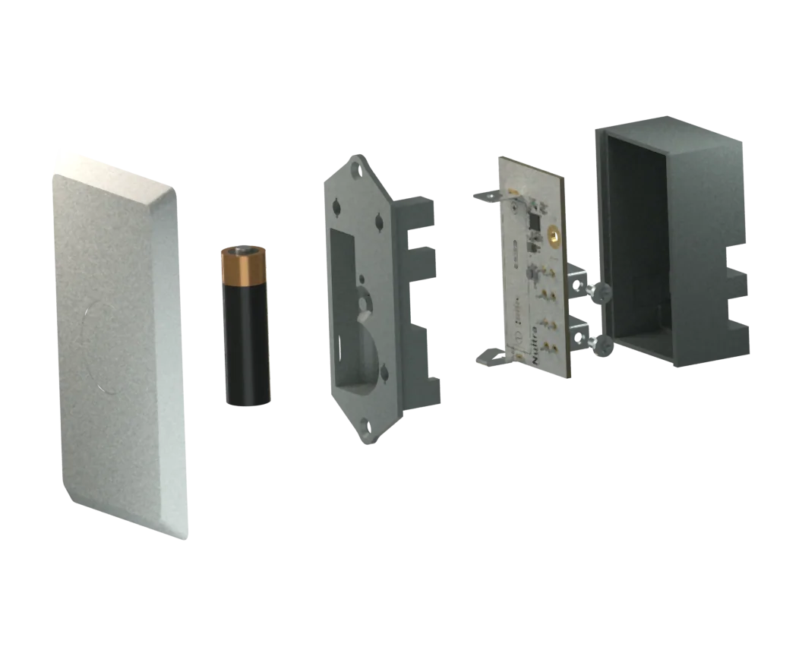

# Nultra

Nultra is a Bluetooth LE wall switch designed for switch boxes without a neutral wire. One AA cell powers the control electronics. A faceplate button or the nearby iPhone and Android apps can operate the latching relay.

[Open the enclosure document in Onshape](https://cad.onshape.com/documents/3cb2e23a19093c4389ce2f07/w/3be343cdcd1e5951d1a37be1)

## Build and use a switch

| What you want to do | Where to start |
| --- | --- |
| Inspect, adapt or print the enclosure | [Mechanical design, STEP solids and printable STL files](hardware/mechanical/) |
| Study the circuit or inspect the original v2 manufacturing outputs | [Electronics, KiCad review findings and archived fabrication files](hardware/README.md#electronics) |
| Build firmware for the STM32WB05KZ and provision a switch | [Firmware build and pairing](firmware/README.md) |
| Control a switch from a phone | [iOS and Android setup](app/README.md) |

Start with the firmware guide when building a new unit. It generates a separate pairing PIN and command password for each switch. Keep the generated header and firmware image private. Owners upgrading older devices should provision fresh credentials, clear old Bluetooth bonds and pair their controllers again.

The KiCad project is an editable conversion with outstanding connectivity findings. For example, the archived v2 board assigns the positive battery contact to `VBATT`, but the corresponding numbered pad is missing in the conversion. Check the archived fabrication files before ordering a changed board. The STEP and STL files can be opened independently of SolidWorks. [Hardware notes](hardware/README.md)

## Project site

The 3D demo opens Nultra on the phone and turns on the room lamp. Scrolling takes over the camera and brings the wall switch into view. The room uses baked light for its lamp-on and lamp-off states. Use the chapter buttons or keyboard-accessible slider to jump directly to the teardown. [Room lighting](tools/render_room.py)

The faceplate lifts first. The AA cell moves forward, exposing the SWD debug pads beneath it. Both sides of the PCB stay in frame as the camera identifies the printed antenna, CPU, DC/DC converter and latching relay. The teardown uses the populated Altium PCB and the project's AA model. Its path-traced images load in small groups. [Render script](tools/render_product.py) · [AA model preparation](tools/prepare_render_battery.py)

J5 carries SWDIO and SWCLK. U1 is the STM32WB05KZ Bluetooth MCU. On the opposite side, U4 is the TPS613221A boost converter and R5 is the Panasonic AGQ21TA2H latching relay. [V2 pad connections](hardware/electronics/fabrication/v2/Nultra-v2-pad-connections.csv) · [V2 bill of materials](hardware/electronics/fabrication/v2/Nultra-v2-BOM.csv)

The battery illustration shows more than a year of use on one AA. Its curve is illustrative. The firmware requests a 2 ms pulse to change the latching relay, then disables the drive. The relay holds its position with its coil unpowered. The controller can sleep between radio events. [Relay drive](firmware/BLE_Peripheral_Lite/Core/Src/main.c#L887) · [Controller sleep](firmware/BLE_Peripheral_Lite/Core/Src/app_entry.c#L310)

To preview the site locally, run `python -m http.server --bind 127.0.0.1 --directory docs 8000` from the repository root.

## Firmware history

Firmware development began in March 2025. The public archive preserves the original commit dates and merges. Device credentials and compiled firmware images were omitted from those revisions. [Browse the 2025 firmware commits](https://github.com/AfshinKI/Nultra/commits/d4c3cc2b9a1dbfadcdf72ec14c10238a79e72ddd/)

## Licenses

The original Nultra hardware uses CERN-OHL-P-2.0. Original software and documentation use MIT. The ST-derived firmware files retain ST’s SLA0044 terms, including its ST-hardware restriction. The license notice identifies those files and other third-party materials. [License scope and notices](LICENSE)
