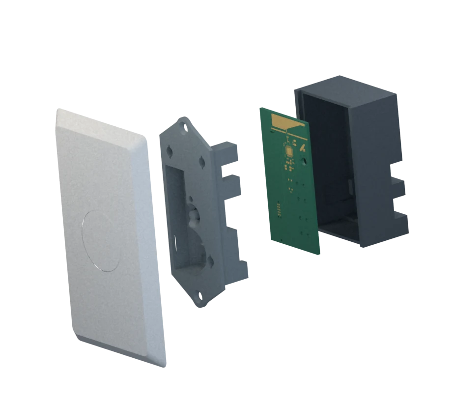

# Nultra

Nultra is a Bluetooth LE wall switch designed for switch boxes without a neutral wire. A battery powers the control electronics and a button on the faceplate operates a latching relay. The iPhone and Android apps control the switch nearby, and an optional Linux gateway adds schedules and timers.

[Explore the switch in an exploded view](https://afshinki.github.io/Nultra/) · [Open the enclosure document in Onshape](https://cad.onshape.com/documents/3cb2e23a19093c4389ce2f07/w/3be343cdcd1e5951d1a37be1)

## Build and use a switch

| What you want to do | Where to start |
| --- | --- |
| Inspect, adapt or print the enclosure | [Mechanical design, STEP solids and printable STL files](hardware/mechanical/) |
| Study the circuit or inspect the original v2 manufacturing outputs | [Electronics, KiCad review findings and archived fabrication files](hardware/README.md#electronics) |
| Build firmware for the STM32WB05KZ and provision a switch | [Firmware build and pairing](firmware/README.md) |
| Control a switch from a phone | [iOS and Android setup](app/README.md) |
| Run a local dashboard, weekly schedule or timer | [Linux Bluetooth gateway](web/README.md) |

Start with the firmware guide when building a new unit. It generates a separate pairing PIN and command password for each switch. Keep the generated header and firmware image private. Owners upgrading older devices should provision fresh credentials, clear old Bluetooth bonds and pair their controllers again.

The KiCad project is an editable conversion with outstanding connectivity findings. For example, the archived v2 board assigns the positive battery contact to `VBATT`, but the corresponding numbered pad is missing in the conversion. Check the archived fabrication files before ordering a changed board. The STEP and STL files can be opened independently of SolidWorks. [Hardware notes](hardware/README.md)

## Project site

The assembly viewer uses a sequence rendered from the enclosure and board geometry. Scroll through the assembly or use its slider to inspect a particular stage. To run the site locally, start `python -m http.server --bind 127.0.0.1 --directory docs 8000` from the repository root and open [the local preview](http://127.0.0.1:8000/).

## Licenses

The original Nultra hardware uses CERN-OHL-P-2.0. Original software and documentation use MIT. The ST-derived firmware files retain ST’s SLA0044 terms, including its ST-hardware restriction. The license notice identifies those files and other third-party materials. [License scope and notices](LICENSE)
